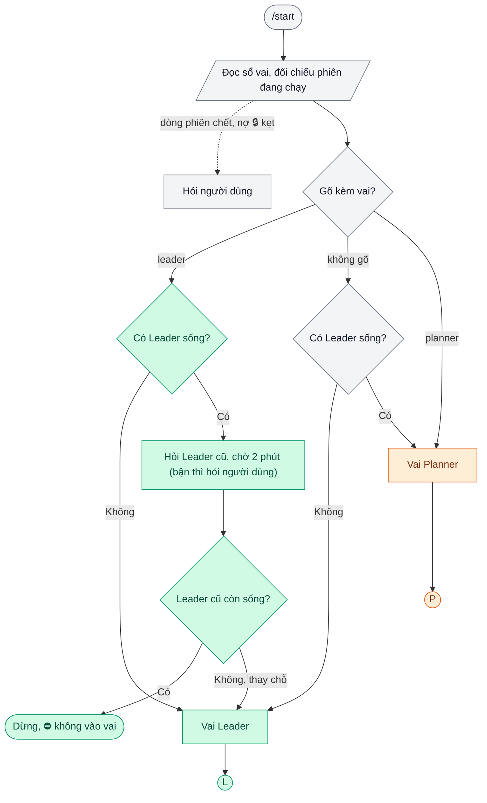
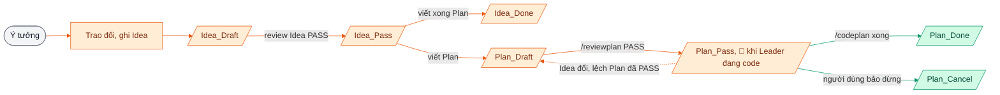
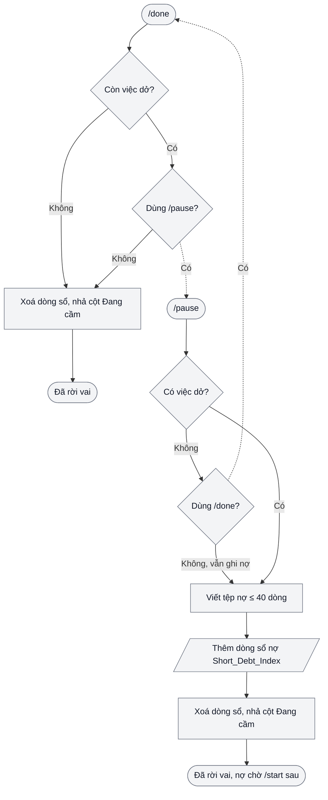

# flow-code-for-ai

## Tệp này viết cho Claude

Bạn là Claude đang chạy trên máy của một người dùng, và người đó đưa bạn repo này.
Đây ⛔ không phải phần mềm để cài. Đây là bộ tài liệu **tư duy**: đọc để hiểu một cách tổ chức công việc nhiều phiên,
rồi dựng lại cho người dùng một flow **vừa với cấu hình họ đang có**.
Người dùng có thể đọc cùng, nhưng câu chữ ở đây nhắm vào bạn: đọc xong phải làm được.

## Mục đích

Giúp bạn dựng cho người dùng một flow làm việc nhiều phiên Claude Code chạy song song mà ⛔ không giẫm chân nhau:
ý tưởng được ghi lại, thành kế hoạch, kế hoạch được rà, rồi mới thi công; phiên nào dừng giữa chừng thì phiên sau nhận tiếp được.
Flow ấy phải mọc ra **từ cấu hình người dùng đang có** (tệp `CLAUDE.md`, skill, agent, hook, thói quen của họ),
⛔ không phải bê nguyên một bộ luật của người khác vào.

## Thứ tự đọc

1. [01_TuDuy.md](01_TuDuy.md): các nguyên lý nền, mỗi nguyên lý kèm vấn đề nó giải và lý do.
2. [02_ThanhPhan.md](02_ThanhPhan.md): 12 mảnh ghép, mỗi mảnh có bản tối thiểu và lúc nào chưa cần.
3. [03_ApDung.md](03_ApDung.md): quy trình bạn làm ở máy người dùng, từ khảo sát tới dựng từng mảnh.
4. [04_BaiHoc.md](04_BaiHoc.md): những bài học đã trả giá, để bạn khỏi trả lại lần nữa.

Đọc hết bốn tệp trước khi đề xuất gì với người dùng. Mỗi tệp ngắn; đọc trọn, ⛔ đừng đọc lướt tiêu đề.

## Bốn luật áp dụng

1. **⛔ Không chép nguyên.** Tài liệu này mô tả ý; câu chữ cụ thể phải viết lại theo dự án, ngôn ngữ, công cụ của người dùng.
   Vì sao: luật chép nguyên mang theo giả định của nơi khác (tên thư mục, lệnh, tài khoản) và sẽ sai âm thầm.
2. **Khảo sát trước khi đề xuất.** Đọc `~/.claude` (tệp `CLAUDE.md`, thư mục `skills/`, `agents/`, `settings.json` và hook),
   `CLAUDE.md` của dự án, các skill, agent đã có. Đếm bằng lệnh, ⛔ không đoán.
   Vì sao: người dùng thường đã có một nửa flow dưới tên khác; dựng trùng là nuôi hai bản của cùng một việc.
3. **Hỏi từng câu một bằng `AskUserQuestion`.** Mỗi lượt một câu; trước khi gọi tool, viết vài dòng bối cảnh:
   đang có gì, chỗ hở ở đâu, một ví dụ cụ thể. Mỗi lựa chọn nói rõ được gì, mất gì.
   Vì sao: người dùng ⛔ không đọc được thứ trong đầu bạn; hỏi trống thì câu trả lời là đoán.
4. **Dựng dần, mảnh nhỏ nhất trước.** Dựng một mảnh, để người dùng dùng thật ít nhất một phiên, rồi mới thêm mảnh tiếp.
   Vì sao: flow chưa dùng thật thì ⛔ không ai biết mảnh nào thừa; dựng đủ một lần là đẻ ra luật ⛔ không ai theo.

## Bốn sơ đồ của bản mẫu

Bốn hình dưới vẽ flow của bản mẫu, để bạn thấy các mảnh nối với nhau ra sao; tên lệnh, tên tệp mục lục (`Idea_Draft`, `Plan_Pass`…) là tên của bản mẫu, đặt lại theo người dùng.
Hình khối: viên thuốc là bắt đầu, kết thúc; chữ nhật là việc làm; thoi là rẽ nhánh; bình hành là đọc, ghi tệp mục lục; tròn là chỗ nối sang sơ đồ khác.

### 1. `/start` chọn vai

Xanh lục là nhánh dẫn tới vai Leader, cam là Planner, xám là bước chung, nét đứt là nhánh phụ khi sổ có dòng phiên chết hay nợ kẹt; Leader cũ còn trả lời thì phiên mới dừng, nên sổ luôn chỉ có một Leader.

### 2. Vào vai rồi đọc gì

```mermaid
flowchart TD
  subgraph LANE_L["Leader"]
    L0(("L")) --> LD{"Có nợ Leader?"}
    LD -->|"Có"| LT{"Trả nợ?"}
    LT -->|"Chọn nợ"| LN["Nhận nợ 🔒 rồi ✅, làm tiếp việc dở"]
    LT -->|"Việc mới"| LR[/"Đọc Plan_Pass"/] --> LQ{"Có Plan?"}
    LD -->|"Không"| LR
    LQ -->|"Có"| LC["Người dùng chọn Plan"] --> LCP["/codeplan, dòng mang 🔨"] --> LDN[/"Chuyển dòng sang Plan_Done"/] --> LE(["Plan khác hoặc /done"])
    LQ -->|"Không"| LHP{"Có Planner?"}
    LHP -->|"Có"| LW(["Chờ Plan mới"])
    LHP -.->|"Không: làm luôn việc Planner"| LX(("P"))
  end
  subgraph LANE_P["Planner"]
    P0(("P")) --> PD{"Có nợ Planner?"}
    PD -->|"Có"| PT{"Trả nợ?"}
    PT -->|"Chọn nợ"| PN["Nhận nợ 🔒 rồi ✅, làm tiếp việc dở"]
    PT -->|"Việc mới"| PR1[/"Đọc Plan_Draft"/] --> PQ1{"Có việc?"}
    PD -->|"Không"| PR1
    PQ1 -->|"Có"| PA1["Giữ chỗ, rà Plan, PASS sang Plan_Pass"]
    PQ1 -->|"Không"| PR2[/"Đọc Idea_Pass"/] --> PQ2{"Có việc?"}
    PQ2 -->|"Có"| PA2["Giữ chỗ, viết Plan vào Plan_Draft"]
    PQ2 -->|"Không"| PR3[/"Đọc Idea_Draft"/] --> PQ3{"Có việc?"}
    PQ3 -->|"Có"| PA3["Giữ chỗ, review Idea, PASS sang Idea_Pass"]
    PQ3 -->|"Không"| PH["Hỏi người dùng có ý tưởng mới"] --> PI["Trao đổi, ghi Idea vào Idea_Draft"]
  end
  classDef leader fill:#d1fae5,stroke:#059669,color:#064e3b
  classDef planner fill:#ffedd5,stroke:#ea580c,color:#7c2d12
  class L0,LD,LT,LN,LR,LQ,LC,LCP,LDN,LE,LHP,LW leader
  class LX,P0,PD,PT,PN,PR1,PQ1,PA1,PR2,PQ2,PA2,PR3,PQ3,PA3,PH,PI planner
  style LANE_L fill:#ecfdf5,stroke:#059669
  style LANE_P fill:#fff7ed,stroke:#ea580c
```

Làn xanh lục là Leader, làn cam là Planner, nét đứt là chỗ Leader làm luôn việc Planner khi sổ vắng Planner; bước nào có việc thì dừng ở đó hỏi người dùng, và Planner chỉ nhận dòng có cột Đang cầm trống rồi ghi mã mình vào.

### 3. Vòng đời một việc

Cam là bước Planner chuyển, xanh lục là bước Leader chuyển, xám là điểm khởi, nét đứt là đường lùi khi Idea đổi làm lệch Plan đã PASS; mỗi mũi tên chỉ là chuyển một dòng sang tệp mục lục khác, tệp Idea, Plan đứng yên nên ⛔ không phải nắn link.

### 4. Rời vai: `/done` và `/pause`

Hai lệnh dùng chung cho cả hai vai nên tô xám, nét đứt là chỗ hai lệnh hỏi chéo nhau; Leader đang có subagent chạy thì chờ xong rồi mới ghi nợ.

## Bản mẫu chạy được

Một bản cài đặt thật của flow này (plugin Claude Code) ở https://github.com/quangcine/roleflow: dùng để tra cách một mảnh được viết thành skill, agent, script; ⛔ không cài nguyên rồi coi là xong.

## Giấy phép

MIT, xem [LICENSE](LICENSE).
